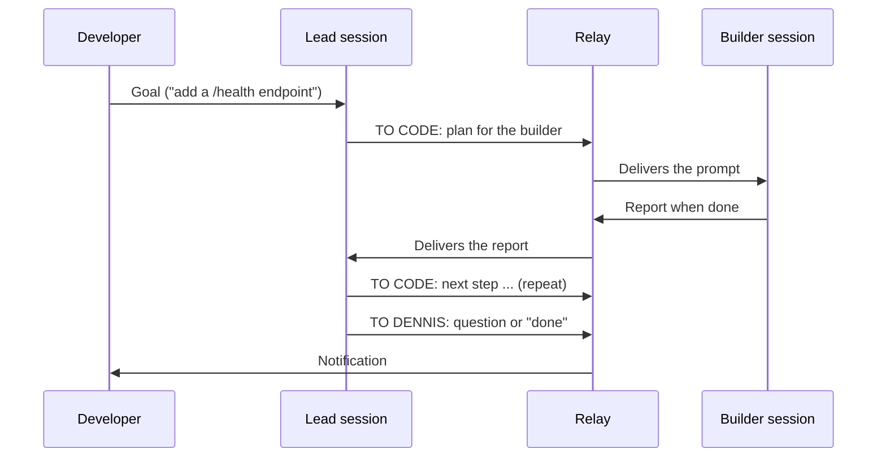

# Relay

[](https://github.com/dennismugu7/relay/actions/workflows/ci.yml)

**Relay passes messages between two Claude Code sessions, a _lead_ and a _builder_, so a developer no longer has to copy and paste between them.**

> **Status:** early development. Stage 1, milestone M0 (repo foundation) is done. Relay does not relay anything yet. See [Project status](#project-status).

## The problem

A productive way to build software with AI is to split the work between two sessions:

- a **lead** that plans the work and reviews the results, and
- a **builder** (Claude Code) that writes the code.

But someone has to carry messages between them. The developer copies the lead's prompt into the builder, waits, then copies the builder's report back to the lead. Every round trip costs time and focus, and all work stops when the developer steps away.

## The solution

Relay carries the messages automatically. The developer still talks to the Claude sessions directly. Relay only watches, passes messages along, shows status, and says when it's the developer's turn.

The lead tags every reply so Relay knows where it goes:

| The lead's reply starts with | Relay does |
|---|---|
| `TO CODE:` | Delivers the message to the builder. |
| `TO DENNIS:` | Notifies the developer and lets the lead stop. |
| no tag | Treats it as `TO DENNIS:` (the safe default). |

The builder's reports always go back to the lead.



Under the hood, each session runs a Claude Code **Stop hook**: a small script Claude Code runs every time Claude finishes a reply. The hook hands the reply to the Relay Helper and waits for the answer from the other side. Only one session works at a time; the other waits without using any usage. Whether this approach works in practice is being tested first (milestone M1).

### Safety rules

- Relay never handles secrets. The builder says what it needs; the developer enters the values.
- A maximum number of rounds per task (default 20), then Relay stops and notifies.
- Pause and Stop always work and are checked before every handoff.
- Every handoff is logged with a timestamp, project, direction and message.

## Getting started (development)

Requirements: **Node.js 22.12 or newer** and npm. Works on Windows 11 (PowerShell) and Linux.

```powershell
git clone https://github.com/dennismugu7/relay.git
cd relay
npm install
npm run check   # format check, lint, typecheck and tests
```

Useful scripts:

| Command | What it does |
|---|---|
| `npm test` | Runs all tests once (Vitest). |
| `npm run test:watch` | Re-runs tests when files change. |
| `npm run lint` | Checks code for bugs and bad patterns (ESLint). |
| `npm run typecheck` | Checks types in every package (TypeScript). |
| `npm run format` | Formats code (Prettier). |
| `npm run check` | All of the above checks, the same as CI. |

The `relay` CLI (`relay init`, `start`, `status`, `log`, `pause`, `resume`, `stop`) arrives in milestone M4.

## Repository layout

```
packages/
  core/     shared types, message tag parsing, state file helpers
  hooks/    the Stop hook script each session runs
  helper/   the Relay Helper background process and the relay CLI
docs/       brief, plans, decisions (ADRs), spikes and the learning journal
```

A guided walk through every folder is in [docs/learning/REPO_TOUR.md](docs/learning/REPO_TOUR.md).

## Tech stack

- **Node.js + TypeScript** (strict mode), in an **npm workspaces** monorepo. Why: [ADR 0001](docs/adr/0001-typescript-and-npm-workspaces.md).
- **Vitest** for tests, **ESLint** + **Prettier** for code quality and style.
- **GitHub Actions** CI on Windows and Ubuntu.

## Project status

| Stage | What it delivers | Status |
|---|---|---|
| 1. Engine on the PC | Hooks, Relay Helper, `relay` CLI; lead and builder run several rounds with no copy-paste | In progress: M0 done |
| 2. Phone alerts | `TO DENNIS:` and "stuck" alerts reach the phone | Planned |
| 3. Android app | Status, activity timeline, Pause/Stop from the phone | Planned |

Details: [docs/PROJECT_BRIEF.md](docs/PROJECT_BRIEF.md) and [docs/plans/stage-1.md](docs/plans/stage-1.md). Changes: [CHANGELOG.md](CHANGELOG.md).

## Learning material

This repo doubles as study material. [docs/learning/](docs/learning/README.md) has a journal for every work session, a bug journal, a glossary and a repo tour.

## License

[MIT](LICENSE)
