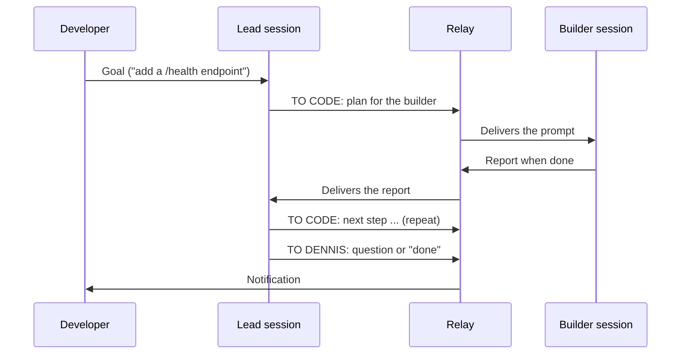

# Relay

[](https://github.com/dennismugu7/relay/actions/workflows/ci.yml)

**Relay passes messages between two Claude Code sessions, a _lead_ and a _builder_, so a developer no longer has to copy and paste between them.**

> **Status:** early development. Stage 1: M0 (repo foundation), M1 (spikes on how Claude Code delivers messages), M2 (the core library), M3 (the hooks) and M4 (the `relay` CLI) are done. `relay init` sets up any project, and a lead and builder then pass messages with no copy-paste ([proof](docs/spikes/011-m4-real-run.md)). See [Project status](#project-status).

## The problem

A productive way to build software with AI is to split the work between two sessions:

- a **lead** that plans the work and reviews the results, and
- a **builder** (Claude Code) that writes the code.

But someone has to carry messages between them. The developer copies the lead's prompt into the builder, waits, then copies the builder's report back to the lead. Every round trip costs time and focus, and all work stops when the developer steps away.

## The solution

Relay carries the messages automatically. The developer still talks to the Claude sessions directly. Relay only watches, passes messages along, shows status, and says when it's the developer's turn.

The lead tags every reply so Relay knows where it goes:

| The lead's reply starts with | Relay does |
|---|---|
| `TO CODE:` | Delivers the message to the builder. |
| `TO DENNIS:` | Notifies the developer and lets the lead stop. |
| no tag | Treats it as `TO DENNIS:` (the safe default). |

The builder's reports always go back to the lead.



Under the hood, each session runs a Claude Code **Stop hook**: a small script Claude Code runs every time Claude finishes a reply. The hook reads the reply's tag, queues the message in a small state file, and then waits in the background. When a message arrives for its session, it wakes the session with it. A second hook marks a session busy while you type, so Relay never interrupts you. Only one session works at a time; the waiting one is idle and uses no usage. There is no background service to run ([ADR 0002](docs/adr/0002-delivery-mechanism.md), [ADR 0005](docs/adr/0005-no-background-helper.md)).

### Safety rules

- Relay never handles secrets. The builder says what it needs; the developer enters the values.
- A maximum number of rounds per task (default 20), then Relay stops and notifies.
- Pause and Stop always work and are checked before every handoff.
- Every handoff is logged with a timestamp, project, direction and message.

## Getting started (development)

Requirements: **Node.js 22.12 or newer** and npm. Works on Windows 11 (PowerShell) and Linux.

```powershell
git clone https://github.com/dennismugu7/relay.git
cd relay
npm install
npm run check   # format check, lint, typecheck and tests
```

Useful scripts:

| Command | What it does |
|---|---|
| `npm test` | Runs all tests once (Vitest). |
| `npm run test:watch` | Re-runs tests when files change. |
| `npm run lint` | Checks code for bugs and bad patterns (ESLint). |
| `npm run typecheck` | Checks types in every package (TypeScript). |
| `npm run format` | Formats code (Prettier). |
| `npm run check` | All of the above checks, the same as CI. |

## Set up Relay on your project

**1. Install the `relay` command** (once). From the Relay repo:

```powershell
npm install
npm run build
cd packages/helper
npm link        # puts "relay" on your PATH; works in PowerShell and Git Bash
relay help
```

After pulling new Relay code, run `npm run build` again. The linked command uses the repo directly. To uninstall, run `npm unlink -g @relay/helper`.

**2. Set up a project:**

```powershell
relay init C:\path\to\my-app
```

This creates the lead's folder **next to** your project (`my-app-lead`) and adds a few files to your project:

| Where | What |
|---|---|
| `my-app-lead\CLAUDE.md` | The lead's instructions: plan and review, never write code, tag every reply. |
| `my-app-lead\relay.config.json` | Settings: max rounds (20), delivery mode, hook timeout. Edit it, then run `relay init` again. |
| `my-app-lead\.claude\settings.json` | The lead's hooks, plus read access to your project. |
| `my-app\.claude\rules\relay-builder.md` | The builder's Relay instructions. |
| `my-app\.claude\skills\relay-start\` | The `/relay-start` command. |
| `my-app\.claude\settings.local.json` | The builder's hooks, merged into the file if you already have one. |

Your own `CLAUDE.md`, `.claude/settings.json` and `.gitignore` are never changed. In a git repo, Relay hides its new files with `.git/info/exclude` (local only), so `git status` stays clean. Running `relay init` again changes nothing, and `relay init --undo C:\path\to\my-app` removes everything it added, restoring changed files exactly ([ADR 0006](docs/adr/0006-init-layout-and-undo.md)).

**3. Run it:**

1. Open Claude Code in `my-app` (the builder) and type `/relay-start`.
2. Open Claude Code in `my-app-lead` (the lead) and give it a goal.
3. Watch, or walk away. The lead replies `TO DENNIS:` when it's done or needs you.

**Commands** (run them in the project or lead folder, or pass the folder):

| Command | What it does |
|---|---|
| `relay status` | Who has the baton, the round count, whether each session's waiter is alive, busy or idle, paused or stopped. |
| `relay log` | The activity log in readable lines (`--full` for whole messages, `--limit 10` for the last 10). |
| `relay pause` / `relay resume` | Hold messages, then deliver them again. |
| `relay stop` | End the run. Sessions stop waiting. |
| `relay start` | Get ready for a new run after a stop. |

## Repository layout

```
packages/
  core/     tag parsing, project config, shared state and activity log
  hooks/    the Stop and UserPromptSubmit hooks each session runs
  helper/   the relay CLI and the templates relay init writes
docs/       brief, plans, decisions (ADRs), spikes and the learning journal
```

A guided walk through every folder is in [docs/learning/REPO_TOUR.md](docs/learning/REPO_TOUR.md).

## Tech stack

- **Node.js + TypeScript** (strict mode), in an **npm workspaces** monorepo. Why: [ADR 0001](docs/adr/0001-typescript-and-npm-workspaces.md).
- **Vitest** for tests, **ESLint** + **Prettier** for code quality and style.
- **GitHub Actions** CI on Windows and Ubuntu.

## Project status

| Stage | What it delivers | Status |
|---|---|---|
| 1. Engine on the PC | Hooks and the `relay` CLI; lead and builder run several rounds with no copy-paste | In progress: M0–M4 done ([real run](docs/spikes/011-m4-real-run.md)); M5, a longer end-to-end run, is next |
| 2. Phone alerts | `TO DENNIS:` and "stuck" alerts reach the phone | Planned |
| 3. Android app | Status, activity timeline, Pause/Stop from the phone | Planned |

Details: [docs/PROJECT_BRIEF.md](docs/PROJECT_BRIEF.md) and [docs/plans/stage-1.md](docs/plans/stage-1.md). Changes: [CHANGELOG.md](CHANGELOG.md).

## Learning material

This repo doubles as study material. [docs/learning/](docs/learning/README.md) has a journal for every work session, a bug journal, a glossary and a repo tour.

## License

[MIT](LICENSE)
