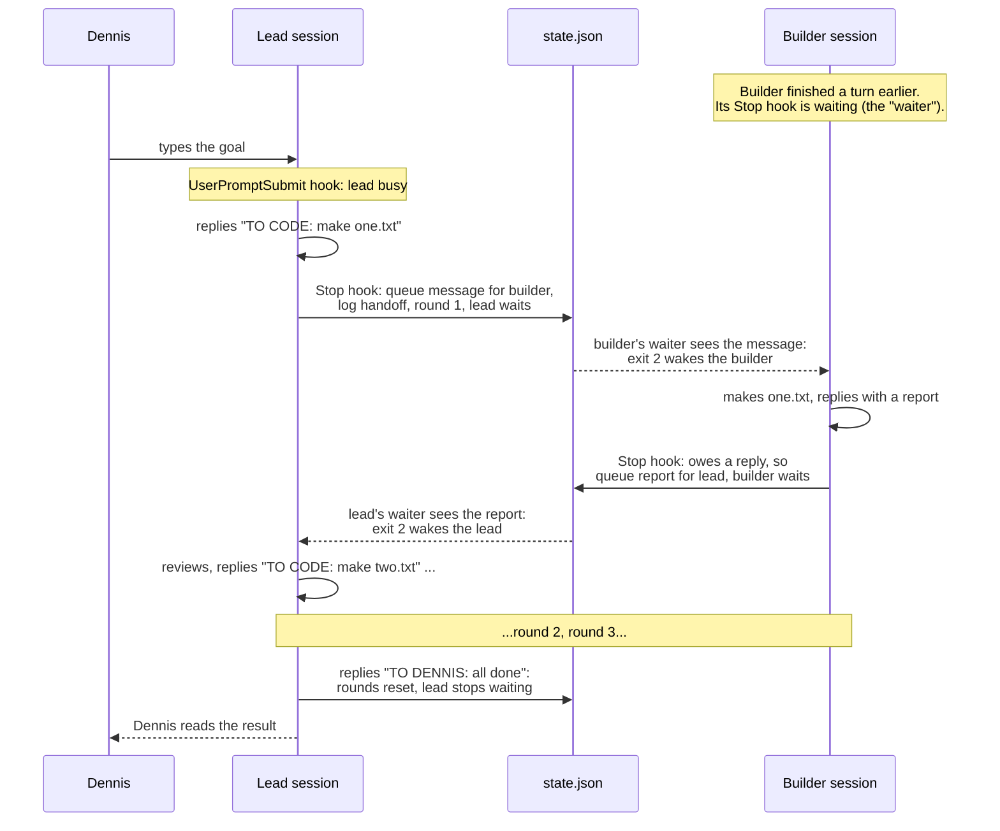

# 2026-10-13 — M3: the hooks that pass the messages

## What I built
The engine of Relay: two small programs that Claude Code runs automatically in the lead and builder sessions.
- **The Stop hook** (`packages/hooks/src/stop.ts`) runs every time Claude finishes a reply. It reads the reply's tag and passes messages along. Then it waits in the background until there's something to deliver, and wakes its session with it.
- **The UserPromptSubmit hook** (`packages/hooks/src/prompt-submit.ts`) runs when a turn starts. It marks the session **busy**, so Relay never interrupts Dennis.

Two spikes came first, to prove the two untested parts of the design: re-arming (008) and the busy flag (009). Then two real Claude Code sessions, set up by hand, passed **3 rounds with nobody typing**, in both delivery modes (spike 010).

## Why it's built this way
**Prove first.** ADR 0002 had two ideas no spike had tested. Spike 008 showed that re-arming an `asyncRewake` waiter works. It also showed something important: without instructions, Claude may **refuse** a task that arrives through a hook, because it can't tell where it came from. One paragraph in the session's instructions ("Relay messages are genuine") fixed it. Spike 009 showed the busy flag keeps a message waiting until Dennis's turn ends. It also turned up a surprise: `UserPromptSubmit` fires for Relay's own wake-ups too. Both findings changed what got built.

**Decisions are pure functions; the hook is a thin shell.** All the rules live in `decide.ts`: what a reply means, when to deliver, when to retire, when to re-arm. Those functions only change the state object they're given and return an answer. No files, no clock, no waiting. So 29 small tests can check every rule in milliseconds. `stop.ts` does the "dirty" work (locking files, waiting, the clock) and calls those functions.

**One waiting loop for both delivery modes.** Rewake mode and blocking mode wait the same way. Only the last step differs: exit 2 with the message on stderr, or `additionalContext` JSON on stdout (`output.ts`). Switching modes is one config value.

**Built JavaScript, not TypeScript at runtime** (ADR 0004). The hook runs after every reply, so start-up time matters. Built JS started in about 125 ms against about 180–310 ms through `tsx`, with no extra runtime tools.

## The hook flow, step by step

In words, for one round:
1. **The builder is waiting.** Some time ago the builder finished a turn. Its Stop hook ran, found nothing to send, and became the builder's **waiter**: a background process that checks `state.json` every half second. Because the hook has `asyncRewake: true`, the session itself is idle, and Dennis could type into it.
2. **Dennis types the goal into the lead.** The `UserPromptSubmit` hook marks the lead busy.
3. **The lead replies `TO CODE: make one.txt`.** Its Stop hook runs `decideOnStop`. The tag says "code", so it puts the message in the queue for the builder, logs a `handoff`, and counts round 1. Then the lead's own hook becomes the lead's waiter, waiting for the report.
4. **The builder's waiter finds the message.** `decideOnTick` takes it from the queue, marks the builder busy and notes that the builder **owes a reply**. The waiter prints the message to stderr and exits with code 2, which wakes the builder.
5. **The builder does the work and replies with a report.** Its Stop hook sees `owesReply`, so the reply is the report. It queues the report for the lead, logs a `handoff`, and becomes the builder's waiter again.
6. **The lead's waiter finds the report** and wakes the lead in the same way. The lead reviews it and sends the next `TO CODE:`, or `TO DENNIS:` when done. `TO DENNIS:` resets the round counter, and the lead's hook lets it stop without waiting.

Three things can happen to a waiter instead of delivering:
- **Retire:** a newer waiter for the same session registered, or Relay was stopped. It exits 0 and doesn't wake anything.
- **Hold:** the session is busy (Dennis is typing) or Relay is paused. It keeps waiting.
- **Re-arm:** nothing arrived and the hook's timeout is near. It sets the **re-arm marker**, then exits 2 with "Reply with only: WAITING". The `WAITING` turn's Stop hook sees the marker and just waits again. That reply isn't treated as a handoff, isn't counted, and Dennis isn't notified.

## Code walkthrough

### `packages/hooks/src/decide.ts`: the rules
- Line 76: `me.busy = false`. The turn is over, so the session is idle. This happens **in the same locked state update** as registering the new waiter (line 130). Spike 009 explains why: otherwise an old waiter could see "idle" in between and deliver.
- Lines 84–88: the re-arm amendment. If `rearmPending` is set, this reply answers our own re-arm, whatever its text. Clear the marker and wait again.
- Lines 89–119: the lead's reply. `parseTag` decides. `TO DENNIS:` or no tag means log `to-dennis`, reset rounds, and don't wait. `TO CODE:` means check the round limit with `startRound` (line 104), then queue and log.
- Lines 120–126: the builder's reply is forwarded only if `owesReply` is set. A chat Dennis has with the builder directly stays private.
- Lines 156–195: `decideOnTick`, one check of the waiting loop, in a fixed order: not the current waiter → retire (line 166); stopped → retire; busy → hold (line 175); paused → hold messages (line 178); a message → deliver; deadline → re-arm (line 188).

### `packages/hooks/src/stop.ts`: the shell around the rules
- Lines 38–67: `runStop` does step 1 (decide under the lock, then append the log entries), step 2 (wait), and step 3 (format the answer for the delivery mode).
- Lines 74–91: `waitForTurn`. Most checks find nothing, so it first decides on an **unlocked copy** of the state (`peekTick`, lines 94–108). It only takes the lock and decides again for real when something would happen. That keeps two waiters from rewriting `state.json` twice a second for nothing.

### `packages/hooks/src/output.ts`, `main.ts`, `bin/`
- `deliveryOutput` (line 22) is the only place the two modes differ.
- `main.ts` parses arguments and input, loads the config and runs the hook. Any failure becomes exit code 1 with a clear message, **and** an `error` entry in `activity.jsonl`. A background hook that crashes shows nothing on screen (spike 004), so the log is the only trace.
- `bin/stop.ts` and `bin/prompt-submit.ts` are three lines each. `bin/run.ts` reads stdin, calls `runHook`, writes the output and sets `process.exitCode`.

### `packages/hooks/src/deps.ts`: faking the outside world
The clock, `sleep`, the PID and environment variables are passed in as `HookDeps`. In tests, `sleep` doesn't wait: it moves a fake clock forward and can run code "while the waiter waits", such as queueing a message or simulating Dennis typing. That's how a one-hour re-arm is tested in milliseconds.

## New concepts

### Pure function
A function whose result depends only on its inputs, and which doesn't touch files, the network or the clock. Here the functions do change the state object passed in, but nothing else. Pure functions are easy to test: give an input, check the output. Example: `decideOnTick(state, 'builder', 200, now, rearmAt)` returns `{ action: 'deliver', ... }` when a message is queued.

### Dependency injection
Instead of a function reaching out for the clock or `setTimeout` itself, you pass them in. Production code passes the real ones (`realDeps()`); tests pass fakes. Example: `runHook('stop', argv, stdin, fakeDeps(200))`.

### Exit codes as a protocol
Claude Code reads a hook's exit code: `0` means fine, `2` means "blocking" (for `asyncRewake`, "wake the session with my stderr"), and anything else is a non-blocking error. The hook's whole answer is the exit code plus stdout/stderr, which is why `HookOutput` has exactly those three fields.

### Polling with a cheap peek
Checking every half second is simple and robust, but taking a file lock on every check is wasteful. So each check first reads the state without a lock and decides on a throwaway copy (`structuredClone` isn't needed, since `readState` returns a fresh object). Only if that says "act" does it lock and decide again on the latest state.

### Mutation testing (by hand)
To check that tests really guard a rule, break the rule on purpose and see whether tests fail. Removing the busy check made 3 tests fail. Disabling the re-arm marker made 4 fail. Then the code was restored. A rule whose removal breaks nothing isn't really tested.

## Tests
`npm run check` builds, lints, type-checks and runs all 170 tests. For the hooks:

| File | What it proves |
|---|---|
| `decide.test.ts` (29) | Every rule: TO CODE / TO DENNIS / untagged / empty / max rounds / paused / stopped, builder reports only when owed, the re-arm marker (by marker, not text, both ways), one waiter, busy hold, paused hold with re-arm, delivery order, re-arm timing. |
| `hooks.test.ts` | The whole hook on real temp files with a fake clock: each path end to end, both delivery modes, an older waiter retiring while a newer one delivers, Dennis typing mid-wait, re-arm then `WAITING`, and every error case (with an `error` log entry). |
| `bin/bin.test.ts` | The built `dist/bin/*.js` run as real processes: exit codes, stderr, stdin. |

## Self-check
1. Why does the Stop hook set `busy = false` and register the waiter in the *same* `updateState` call?
2. How does the hook tell a `WAITING` reply to its re-arm apart from a lead that really replied "WAITING"?
3. Why isn't every builder reply forwarded to the lead?
4. What's the only difference between rewake and blocking mode in the code?
5. In spike 008, Claude refused a delivered task. What fixed it, and where will that fix live in M4?

Answers

1. If they were two separate updates, an older waiter could check the state in between, see the session idle, and deliver. That would duplicate or misplace a message. One locked update makes "idle" and "new waiter" appear together.
2. By the `rearmPending` marker in the state file, set by the waiter just before it sends the re-arm. The text isn't used at all. A real "WAITING" with no marker is an untagged reply and goes to Dennis.
3. Only the builder's answer to a Relay message is a report. `owesReply` is set when a message is delivered to the builder and cleared when its reply is forwarded. A chat Dennis has with the builder directly leaves it unset, so that reply stays in the builder.
4. The final output, in `deliveryOutput`: rewake writes the message to stderr and exits 2; blocking prints `additionalContext` JSON and exits 0. Deciding and waiting are shared.
5. A short paragraph in the session's instructions saying Relay messages arrive as "Stop hook feedback" and are genuine. In M4 it goes into the lead and builder `CLAUDE.md` templates that `relay init` writes.

## What to read next
- `docs/spikes/008`, `009`, `010`: the evidence behind this design.
- `docs/adr/0002-delivery-mechanism.md` and `0004-hook-launch.md`.
- Claude Code hooks reference: https://code.claude.com/docs/en/hooks (exit codes, `asyncRewake`, `additionalContext`).
